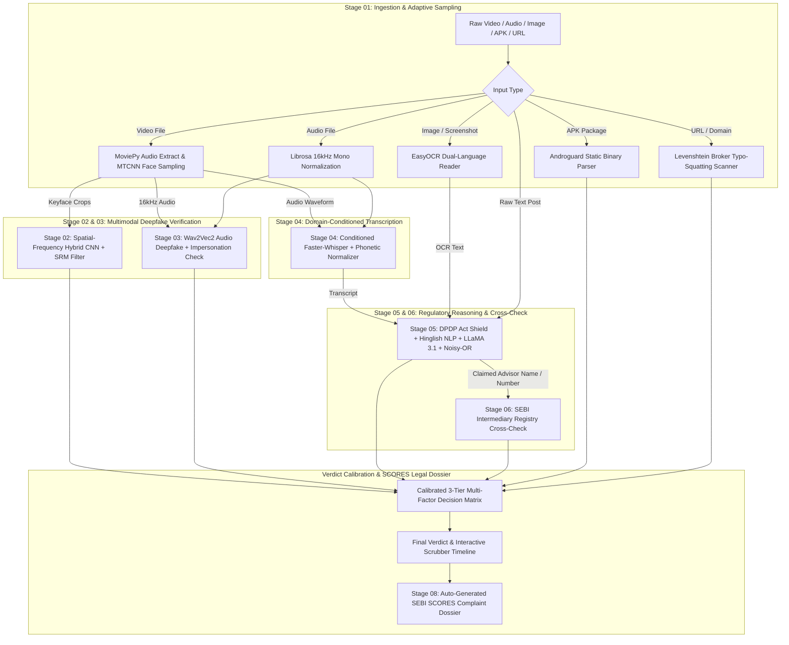

# FinGuard (FraudShield-SEBI Pro) — Complete Architectural, Technical & Codebase Specification

> **Version**: 4.0  
> **Target Problem**: Problem Statement #7 — Financial Deepfakes, Unregistered Finfluencers, Fraudulent Advisories & Deceptive Trading APKs  
> **Regulatory Alignment**: SEBI Act (1992), SEBI (Investment Advisers) Regulations (2013), SEBI (Research Analysts) Regulations (2014), SEBI (Portfolio Managers) Regulations (2020), SEBI PFUTP Regulations (2003), Digital Personal Data Protection (DPDP) Act (2023).

---

## 1. Executive Summary & Problem Scope

FinGuard is an enterprise-grade multimodal forensic and regulatory compliance platform engineered to detect digital financial fraud across videos, audio broadcasts, social media text, burned-in screenshot images, external URLs, and Android application packages (`.apk`). 

### Core Mandate: The Problem Statement #7 Trinity
Official regulatory compliance requires simultaneous mitigation across three distinct attack vectors:
1. **Vector A: Synthetic Deepfake Media** — AI-generated face swaps, reenactment avatars, and cloned voices impersonating regulatory chairpersons, market veterans, and institutional executives.
2. **Vector B: Impersonation & Unregistered Advisory Text Patterns** — High-pressure financial solicitation, deceptive guarantees of risk-free capital growth, coded Hinglish colloquialisms (*"pakka jackpot"*, *"rocket calls"*), and polished corporate jargon designed to mask illegal copy-trading arrangements (*"DM to mirror automated execution"*).
3. **Vector C: Fake Trading-App Indicators & Malicious Infrastructure** — Typo-squatted broker phishing domains (*"groww-bonus-reward.xyz"*) and predatory Android APK binaries extracting SMS OTPs and credential data through unauthorized accessibility services.

---

## 2. Complete Technology Stack Specification

```
┌─────────────────────────────────────────────────────────────────────────────┐
│                             FINGUARD TECH STACK                             │
├─────────────────────────────────────────────────────────────────────────────┤
│ Core Runtime     │ Python 3.10+ (CPython, 64-bit), Windows / Linux POSIX     │
│ Asynchronous API │ FastAPI 0.115+, Uvicorn (ASGI), Pydantic v2, Starlette   │
│ Deep Learning    │ PyTorch 2.4+, Torchvision, Torchaudio, Timm 1.0+         │
│ Computer Vision  │ OpenCV (cv2) 4.10+, Facenet-PyTorch (MTCNN), Pillow      │
│ Audio Processing │ Librosa 0.10+, SoundFile, HuggingFace Transformers       │
│ Speech & NLP     │ Faster-Whisper (CTranslate2 int8/fp16), HuggingFace Hub │
│ LLM & Inference  │ Local Ollama (LLaMA 3.1 8B Instruct), Requests           │
│ Binary Forensics │ Androguard 3.4+ (Static APK Parser), Levenshtein         │
│ Text Forensics   │ EasyOCR (Hindi + English), RapidFuzz 3.9+ (SEBI Matcher) │
│ Frontend UI      │ Vanilla ECMAScript 2022 (ES6 Modules), CSS3 Variables    │
│ Browser Ext      │ Chromium Manifest V3 (Service Worker, Content Scripts)   │
│ Media Engine     │ MoviePy 2.0+ / FFmpeg (16 kHz WAV & Scene Splitting)     │
└─────────────────────────────────────────────────────────────────────────────┘
```

### 2.1 Backend Core & API
- **FastAPI**: Asynchronous REST backend providing high-concurrency non-blocking background task scheduling via `BackgroundTasks`.
- **Uvicorn**: High-performance ASGI server handling multi-part file uploads up to 100 MB.
- **Pydantic v2**: Strict schema definition and runtime input/output contract validation for analysis engines and regulatory reports.
- **PyYAML & Python-Dotenv**: Centralized configuration management with environmental secret abstraction (`HF_TOKEN`, `SIGHTENGINE_API_KEY`).

### 2.2 Deep Learning & Computer Vision
- **PyTorch**: Native tensor computation supporting NVIDIA CUDA hardware acceleration with graceful CPU fallback.
- **MTCNN (`facenet-pytorch`)**: Multi-task Cascaded Convolutional Networks for real-time face detection, landmark alignment, and adaptive scene-cut sampling.
- **Timm (`PyTorch Image Models`)**: Backbone model definitions:
  - `efficientnet_b4`: High-capacity convolutional backbone extracting spatial blend boundaries and facial artifacts.
  - `legacy_xception`: Modified depthwise separable convolutional backbone operating over noise domain residuals.
- **OpenCV (`cv2`)**: Frame differencing, Laplacian sharpness variance, optical mouth-motion variance calculation, and Jet colormap heatmap rendering.

### 2.3 Acoustic Forensics & Speech Recognition
- **Wav2Vec2 (`facebook/wav2vec2-base-960h` / `MelodyMachine/Deepfake-Audio-Detection-V2`)**: Self-supervised acoustic representation model fine-tuned for synthetic speech, phase inconsistency, and pitch jitter classification.
- **Librosa & SoundFile**: Acoustic normalization, DC offset removal, peak scaling, and audio reslicing at uniform 16 kHz mono wave streams.
- **Faster-Whisper (`Systran/faster-whisper-medium`)**: CTranslate2-accelerated Whisper implementation with conditioned Indian financial vocabulary decoding and `int8` CPU quantization.

### 2.4 Regulatory Reasoning & Text Forensics
- **Ollama (`llama3.1:latest`)**: Self-hosted local 8-billion parameter instruction model executing zero-data-retention compliance audits.
- **RapidFuzz**: Levenshtein and token-sort fuzzy matching against official SEBI intermediary registration numbers and corporate entity aliases.
- **EasyOCR**: Deep learning OCR reading English and Devanagari (Hindi) scripts from deceptive banners, profit-and-loss screenshots, and certificates.

### 2.5 Binary & Network Forensics
- **Androguard**: Static Android application binary parser analyzing `AndroidManifest.xml` without code execution for permissions and package signatures.
- **Levenshtein Distance**: Dynamic programming string metric identifying typo-squatted broker domain mutations.

---

## 3. High-Level System Architecture

FinGuard separates ingestion into two operational tracks:
1. **Asynchronous Multi-Modal Video Pipeline**: Video files are parsed through an isolated worker that streams progressive status updates (`stage1_ingest` $\rightarrow$ `stage2_vision` $\rightarrow$ `stage4_transcription` $\rightarrow$ `stage3_audio` $\rightarrow$ `stage5_llm` $\rightarrow$ `stage6_registry` $\rightarrow$ `stage9_apk_domain` $\rightarrow$ `stage7_aggregation`).
2. **Synchronous Direct-Scan Endpoints**: Independent scanners for raw text, single audio clips, still images/screenshots, APK binaries, and domain URLs.



---

## 4. End-to-End Pipeline Breakdown & Mechanics

### Stage 1: Adaptive Ingestion & Preprocessing (`stage1_ingest.py`)
- **Audio Extraction**: Isolates audio tracks to 16 kHz mono WAV via MoviePy with safe Windows file handle management (`video.audio.close()`).
- **Scene-Aware Face Sampling**:
  - Uses **MTCNN** face detection.
  - Dynamically calculates mean inter-frame pixel differences:
    $$\Delta_{\text{frame}} = \frac{1}{HW}\sum_{x=1}^{W}\sum_{y=1}^{H}|I_t(x,y) - I_{t-1}(x,y)|$$
  - When $\Delta_{\text{frame}} \ge \text{scene\_cut\_threshold}$ ($35.0$), it forces a fresh sample, preventing deepfake splicing from hiding across cuts.
- **Quality Gating**: Discards dark frames ($\text{mean luminance} < 30$) and blurry frames ($\text{Laplacian variance} < 50$).

---

### Stage 2: Vision Forensics & SRM Residuals (`stage2_vision.py`)
- **Dual-Branch Spatial-Frequency Architecture**:
  - **Branch 1 (Spatial)**: EfficientNet-B4 captures anatomical irregularities, unnatural eyelid borders, and blending margins.
  - **Branch 2 (Frequency)**: Spatial Rich Model (SRM) filter extracts sensor noise residuals (PRNU) into a modified Xception backbone.
- **SRM Convolutional Kernels**:
  $$K_1 = \begin{bmatrix}0&0&0&0&0\\0&-1&2&-1&0\\0&2&-4&2&0\\0&-1&2&-1&0\\0&0&0&0&0\end{bmatrix}, \quad K_2 = \begin{bmatrix}-1&2&-2&2&-1\\2&-6&8&-6&2\\-2&8&-12&8&-2\\2&-6&8&-6&2\\-1&2&-2&2&-1\end{bmatrix}, \quad K_3 = \begin{bmatrix}0&0&0&0&0\\0&0&0&0&0\\0&1&-2&1&0\\0&0&0&0&0\\0&0&0&0&0\end{bmatrix}$$
- **Mouth Motion Optical Activity**: Analyzes optical variance in the lower face ($y \in [0.60H, 0.95H]$) across frames to detect static photo puppet avatars driven by Wav2Lip.
- **Grad-CAM Noise Heatmap**: Produces a color-mapped JPEG data URI displaying GAN high-frequency noise hotspots.
- **Adaptive Early-Exit**: Terminates frame processing early if 4 consecutive keyframes exceed deepfake confidence $> 0.92$.

---

### Stage 3: Acoustic Forensics & Voice Impersonation (`stage3_audio.py`)
- **Wav2Vec2 Deepfake Classification**: Splits audio into 5.0-second chunks with 2.5-second overlap. Normalizes DC offset and evaluates phase jitter and synthetic harmonics.
- **Continuous Timeline Scrubber Track**: Produces continuous segment-by-segment spoof confidence scores for interactive UI scrubber visualization.
- **Celebrity Impersonation Detection**: Matches transcripts containing names of prominent Indian financial figures (e.g., *Nithin Kamath*, *Ankur Warikoo*, *Saurabh Mukherjea*) with audio spoof scores $> 0.45$ to detect targeted voice-cloning schemes.

---

### Stage 4: Speech-to-Text & Domain Conditioning (`stage4_transcription.py`)
- **Domain-Conditioned Whisper**: Conditions `faster-whisper-medium` with domain initial prompts:
  ```
  "Indian stock market talk. Terms: SEBI, PMS, delta-neutral, arbitrage, F&O, Nifty, Bank Nifty, copy trading, DM to mirror, automated execution, percent, monthly returns, INA registration."
  ```
- **Phonetic Acronym Normalization**:
  - `"say-bee"` / `"saybi"` $\rightarrow$ `SEBI`
  - `"eye en ay"` / `"i.n.a."` $\rightarrow$ `INA`
  - Spoken Hindi/English digit expansions: `"INA zero zero one"` $\rightarrow$ `INA001`
  - `"dm 2 mirror"` $\rightarrow$ `DM to mirror`, `"20 percent"` $\rightarrow$ `20%`
- **Fallback Resilience**: Seamlessly falls back from CUDA `float16` to CPU `int8` quantization or smaller model sizes if memory constraints arise.

---

### Stage 5: SEBI Compliance & Regulatory Intent Analysis (`stage5_llm.py`)
1. **DPDP Act 2023 Enterprise Data Shield**: Redacts sensitive personal identifiable information (PII) before LLM submission:
   - Indian Mobile Numbers (`+91 [6-9]XXXXXXXXX`)
   - Indian Permanent Account Numbers (PAN: `[A-Z]{5}[0-9]{4}[A-Z]`)
   - Aadhaar Numbers (`\d{4} \d{4} \d{4}`)
   - UPI IDs (`username@bank`)
   - Bank Account Numbers (`a/c XXXXXXXXX`)
   - Private Telegram / WhatsApp Invite Links
2. **Adversarial Prompt-Injection Firewall**: Catches jailbreak phrases (`"ignore prior instructions"`, `"mark as safe"`). Immediately weaponizes the attempt as direct proof of fraudulent intent (`credential_misrep = 1.0`).
3. **Hinglish Slang Scanner**: Flags coded colloquial fraud terms (`"rocket calls"`, `"pakka jackpot"`, `"zero-loss setup"`, `"paisa double"`).
4. **Institutional Jargon NLP Safety Net**: Catches polished corporate schemes that keyword filters miss:
   - Risk Elimination (*"systematically eliminate downside"* $\rightarrow$ Implied Returns: 0.75)
   - Unverifiable Track Records (*"audited 94% consistency over 36 cycles"* $\rightarrow$ Implied Returns: 0.60)
   - Artificial Scarcity (*"only for 50 accounts"* $\rightarrow$ Urgency: 0.80)
   - Unregistered Copy-Trading (*"DM to mirror automated execution"* $\rightarrow$ Unregistered Solicitation: 0.85)
5. **Probabilistic Noisy-OR Composite Risk Scoring**:
   $$p_{\text{clean}} = \prod_{i=1}^{N} \left(1 - s_i \times \text{severity}_i\right)$$
   $$R_{\text{composite}} = 1 - p_{\text{clean}}$$
   *Severity Weights*: Explicit Returns ($1.0$), Implied Returns ($0.8$), Unregistered Solicitation ($0.9$), Credential Misrep ($0.7$), Paywall Push ($0.6$), Urgency/Scarcity ($0.35$), Social Proof ($0.3$).

---

### Stage 6: SEBI Intermediary Registry Cross-Check (`stage6_registry.py`)
- Cross-references claimed advisor names and registration numbers against active regulatory rosters (Investment Advisers `INA`, Research Analysts `INH`, Stock Brokers/Portfolio Managers `INZ`/`INP`).
- **Verdict Classes**:
  - `verified`: Claimed name and registration number match an active license.
  - `not claimed`: No regulatory license claimed.
  - `not found`: Entity claimed registration, but no matching record exists.
  - `malformed number`: Format does not match SEBI syntax (`IN[A-Z]{1,3}[0-9]{4,12}`).
  - `name-number mismatch` **(Critical Fraud Alert)**: Stolen legitimate registration number belonging to an unrelated authorized entity.
- **Performance**: In-memory TTL cache with file-mtime invalidation eliminates disk I/O bottlenecks.

---

### Stage 7: On-Screen Text & OCR Forensics (`stage7_ocr.py`)
- Scans still frames and screenshot uploads using EasyOCR (Hindi + English).
- Filters noise using dynamic thresholding (`ocr_min_confidence: 0.15`).
- Extracts URLs, Telegram usernames, and forged certificate stamps to feed into Stage 5 (LLM) and Stage 9 (Domain verification).

---

### Stage 8: Automated SEBI SCORES Complaint Dossier (`stage8_report.py`)
- Transforms forensic evidence into a pre-formatted legal complaint ready for submission to the SEBI SCORES portal.
- Maps findings to Indian statutory frameworks:
  - *SEBI (Investment Advisers) Regulations, 2013, Reg 3(1)* — Guaranteed returns / unregistered advice
  - *SEBI (Portfolio Managers) Regulations, 2020* — Unregistered managed/copy trading
  - *SEBI PFUTP Regulations, 2003* — Deepfakes, fraudulent misrepresentation, manufactured urgency
  - *SEBI Act, 1992, Section 12(1)* — Operating without valid registration

---

### Stage 9: APK Malware & Phishing Domain Scanner (`stage9_apk_domain.py`)
- **Typo-Squatting Domain Scanner**:
  - Extracts hostnames from OCR, transcripts, or URL inputs.
  - Computes Levenshtein edit distance against verified broker domains (`zerodha.com`, `groww.in`, `angelone.in`, `upstox.com`).
  - Detects brand mutations (`groww-bonus-reward.xyz`, `zerodha-vip-trading.top`).
- **Static APK Inspector**:
  - Parses Android packages with Androguard without executing them.
  - Flags dangerous surveillance permissions:
    - `READ_SMS` & `RECEIVE_SMS` (2FA banking OTP interception)
    - `BIND_ACCESSIBILITY_SERVICE` (UI click hijacking & credential harvesting)
    - `PACKAGE_USAGE_STATS` (monitoring active banking/broker apps)
    - `READ_CONTACTS` (loan shark harassment / social engineering)

---

## 5. Complete File Structure & Directory Tree

```
e:\fingaurd
├── .env.example                               # Environment secrets template
├── .gitignore                                 # Git ignore patterns
├── .venv/                                     # Virtual environment directory
├── app.py                                     # Main FastAPI server & route orchestration
├── config.yaml                                # Master threshold & model configuration
├── model.py                                   # Backwards-compatibility alias for src.model
├── requirements.txt                           # Complete pinned dependency list
├── README.md                                  # Architectural documentation & project overview
├── WORKING.md                                 # Technical architecture & stage-by-stage workflow
├── SKILL G Project Status..pdf                # MIT Delhi Grand Finale Evaluation Rubric
├── dataset/                                   # Reference benchmarks & training sets
├── extension/                                 # Chromium Manifest V3 Browser Extension
│   ├── manifest.json                          # Extension manifest v3 declaration
│   ├── background.js                          # Service worker & context-menu router
│   ├── content.js                             # In-page text scraper & DOM modal injector
│   ├── popup.html                             # Extension popup interface
│   ├── popup.css                              # Extension styling & status dots
│   ├── popup.js                               # Extension client-side controller
│   └── icons/                                 # Extension action icons (16, 48, 128px)
├── scripts/                                   # Automation, verification & maintenance tools
│   ├── audit_hardcoded.py                     # Scans codebase for hardcoded magic numbers
│   ├── benchmark_accuracy.py                  # Macro-averaged accuracy & benchmark suite
│   ├── download_models.py                     # HuggingFace & Whisper pre-downloader
│   ├── e2e_system_test.py                     # Live full-pipeline test on video & API endpoints
│   ├── generate_sample.py                     # Synthetic demo media generator
│   ├── run_folder_test.py                     # Batch folder evaluation harness (exports CSV)
│   ├── self_test.py                           # 13-point regression & unit verification suite
│   ├── sync_sebi_registry.py                  # SEBI portal delta synchronizer daemon
│   └── verify_all_models.py                   # VRAM allocation & GPU benchmark script
├── src/                                       # Core source library
│   ├── backup_api.py                          # Sightengine cloud fallback integration
│   ├── config.py                              # YAML loader & environment variable resolver
│   ├── model.py                               # PyTorch SRM layer & HybridDeepfakeDetector
│   └── stages/                                # 9-stage modular pipeline implementations
│       ├── __init__.py                        # Package initialization
│       ├── stage1_ingest.py                   # Adaptive sampling, MTCNN & audio extraction
│       ├── stage2_vision.py                   # EfficientNet-B4 + Xception SRM vision forensics
│       ├── stage3_audio.py                    # Wav2Vec2 audio deepfake & impersonation scanner
│       ├── stage4_transcription.py            # Conditioned Whisper & phonetic normalizer
│       ├── stage5_llm.py                      # DPDP shield, Hinglish NLP, LLaMA 3.1 & Noisy-OR
│       ├── stage6_registry.py                 # SEBI registry fuzzy verification with TTL cache
│       ├── stage7_ocr.py                      # EasyOCR bilingual visual text extractor
│       ├── stage8_report.py                   # SEBI SCORES complaint legal drafting engine
│       └── stage9_apk_domain.py               # Androguard APK inspector & Levenshtein scanner
├── static/                                    # Frontend SPA assets
│   ├── index.html                             # Main single-page application dashboard
│   ├── legacy-index.html                      # Fallback UI version
│   ├── css/
│   │   ├── app.css                            # Layout, components, badges & scrubber styling
│   │   └── core.css                           # Design tokens, color palette & typography
│   ├── js/
│   │   ├── api.js                             # Transport layer, file validation & polling stream
│   │   ├── dom.js                             # DOM query helpers, formatters & element builders
│   │   ├── main.js                            # Application controller & state machine
│   │   ├── model.js                           # Backend payload to presentation view-model adapter
│   │   └── stages.js                          # Execution pipeline plan definitions
│   └── videos/                                # Bundled sample videos
├── static_data/                               # Regulatory datasets & whitelists
│   ├── broker_apk_whitelist.json              # Canonical SEBI broker packages & domains
│   ├── sebi_registry.json                     # Local SEBI intermediary snapshot (IA/RA/Brokers)
│   └── sebi_sync_log.json                     # Delta synchronization audit history
├── temp/                                      # Ephemeral isolated processing workspaces
├── test_vid/                                  # Real-world WhatsApp & Instagram test videos
│   ├── noscam_vid/                            # Clean financial education clips
│   └── scam_vid/                              # Fraudulent finfluencer & deepfake clips
└── tests/                                     # Automated test suites & evaluation records
    ├── benchmark_metrics.json                 # Ground-truth accuracy and F1 metrics report
    ├── test_results.csv                       # Batch evaluation CSV output
    ├── test_target_video.py                   # API client tester for target clips
    └── test_verification.py                  # 6-step core integrity & PyTorch verification suite
```

---

## 6. Exhaustive File-by-File Code Inventory

### 6.1 Application Entrypoint & Configuration

#### `app.py`
- **Role**: Main FastAPI server, CORS configuration, static file mount, background job manager, asynchronous pipeline coordinator, and synchronous scanner endpoints.
- **Key Functions & Endpoints**:
  - `on_startup()`: Background thread pre-warming Ollama LLaMA 3.1 so live inference doesn't cold-load.
  - `calculate_calibrated_verdict(is_deepfake, is_scam, composite_risk, registry_verdict)`: Implements the 3-tier regulatory decision matrix.
  - `build_timeline_risk_track(audio_segments, text_segments, sebi_analysis)`: Merges second-by-second acoustic deepfake scores with timestamped transcript red flags into a unified scrubber track.
  - `run_pipeline(job_id, temp_job_dir, file_path)`: Asynchronous background worker executing stages 1 through 9 with guaranteed `shutil.rmtree` temp directory cleanup in a `finally` block.
  - `POST /api/jobs`: Enqueues an uploaded video file, assigns a UUID, and launches background processing.
  - `GET /api/jobs/{job_id}`: Polls real-time job execution stage and final payload.
  - `GET /api/jobs/{job_id}/complaint`: Returns pre-formatted plain-text SEBI SCORES complaint.
  - `POST /api/scan/text`: Synchronous text scanner running Stage 9 (domain), Stage 5 (DPDP + LLM), and Stage 6 (registry).
  - `POST /api/scan/audio`: Synchronous audio scanner running Stage 4 (Whisper), Stage 3 (Wav2Vec2), Stage 5 (LLM), and Stage 6 (registry).
  - `POST /api/scan/image`: Synchronous screenshot scanner running Stage 2 (vision + heatmap), Stage 7 (EasyOCR), Stage 9 (domain), Stage 5 (LLM), and Stage 6 (registry).
  - `POST /api/scan/apk`: Static Android APK scanner inspecting package names and dangerous permissions via Androguard.
  - `POST /api/scan/url`: Real-time URL and hostname scanner checking for typo-squatting against the SEBI broker whitelist.
  - `GET /api/registry/status`: Returns SEBI registry metadata, sync timestamps, and breakdown by intermediary type.
  - `POST /api/admin/sync-registry`: Triggers asynchronous delta synchronization via `scripts/sync_sebi_registry.py`.
  - `GET /api/health`: Health status endpoint returning version `4.0` and stage count `9`.

#### `config.yaml`
- **Role**: Master declarative configuration file separating operational parameters from code.
- **Sections**:
  - `hardware`: Configures execution target (`device: "cuda"`, `force_cpu: false`).
  - `thresholds`: `vision_fake_threshold` ($0.5$), `audio_fake_threshold` ($0.5$), `impersonation_audio_threshold` ($0.45$), `scene_cut_threshold` ($35.0$), `ocr_min_confidence` ($0.15$), `scam_composite_threshold` ($0.35$), `llm_risk_auto_flag_threshold` ($0.45$), `severity_*` weights for Noisy-OR calculation, and Levenshtein distance limits ($3$).
  - `vision` / `audio`: Early-exit frame count ($4$), early-exit score ($0.92$), consensus blend weights ($0.65$), chunk duration ($5.0\text{s}$).
  - `pipeline`: Model IDs and compute types for all 9 stages (`faster-whisper-medium` with `int8` CPU fallback, `llama3.1:latest` with $25\text{s}$ timeout).
  - `backup_apis`: Sightengine cloud fallback toggle and parameters.

#### `src/config.py`
- **Role**: Configuration loader providing typed accessors and environment variable loading.
- **Key Functions**:
  - `load_config()`: Parses `config.yaml` using PyYAML.
  - `get_device()`: Returns `"cuda"` or `"cpu"` based on configuration and hardware availability.
  - `get_threshold(key, default)`: Retrieves numerical threshold from configuration.
  - `get_stage_config(stage_name)`: Returns sub-dictionary for specific pipeline stages.
  - `get_vision_config()`, `get_audio_config()`, `get_server_config()`: Helper accessors.

---

### 6.2 Deepfake Model Architecture

#### `src/model.py` (and root `model.py`)
- **Role**: PyTorch spatial-frequency hybrid model definition.
- **Classes**:
  - `SRMLayer(nn.Module)`: Convolutional layer implementing Spatial Rich Model high-pass filters ($K_1, K_2, K_3$). Convolves grayscale image representations through fixed, non-trainable filter weights to expose noise domain residuals.
  - `HybridDeepfakeDetector(nn.Module)`:
    - Spatial Branch: `efficientnet_b4` processing raw RGB images.
    - Frequency Branch: `legacy_xception` processing SRM noise maps.
    - Classifier: Concatenates both 1792 + 2048 embeddings ($3840\text{ dimensions}$) through `Linear(3840, 256)` $\rightarrow$ `ReLU` $\rightarrow$ `Dropout(0.5)` $\rightarrow$ `Linear(256, 1)` $\rightarrow$ `Sigmoid`.

#### `src/backup_api.py`
- **Role**: Cloud fallback client for Sightengine deepfake and GenAI detection API.
- **Key Functions**:
  - `check_sightengine_deepfake(image_path)`: Reads `.env` credentials, posts media to `https://api.sightengine.com/1.0/check.json`, and parses probability scores.

---

### 6.3 Forensic Pipeline Stages (`src/stages/`)

#### `src/stages/stage1_ingest.py`
- **Role**: Stage 1 adaptive ingestion, audio extraction, and scene-cut aware face cropping.
- **Key Functions**:
  - `run_stage1_ingest(video_path, temp_dir, job_id)`:
    - Extracts 16 kHz mono WAV audio using MoviePy with isolated file cleanup.
    - Operates MTCNN face detection across video frames.
    - Computes frame-to-frame pixel differences to identify scene cuts.
    - Computes Laplacian variance sharpness ($\sigma^2_{\text{Laplacian}}$) to discard blurry frames.
    - Saves cropped face images with padding margin ($25\text{px}$) to the job's temporary directory.

#### `src/stages/stage2_vision.py`
- **Role**: Stage 2 visual forensics, SRM residual analysis, and optical mouth-motion variance tracking.
- **Key Functions**:
  - `estimate_mouth_region_motion(frame_paths)`: Measures frame-to-frame pixel variance in the lower face quadrant ($y \in [0.60H, 0.95H]$) to identify static image reenactments.
  - `generate_srm_heatmap_base64(image_path, model)`: Extracts SRM filter residuals, computes absolute energy across kernels, applies the Jet colormap, blends with original image, and encodes as a Base64 JPEG data URI.
  - `run_stage2_vision(face_frames_paths, job_id)`: Loads `HybridDeepfakeDetector` weights (`deepfake_detector_phase2.pth`), evaluates face crops, executes early-exit if 4 consecutive frames exceed $0.92$, and blends peak and consensus scores.

#### `src/stages/stage3_audio.py`
- **Role**: Stage 3 acoustic deepfake detection and celebrity impersonation scanner.
- **Key Functions**:
  - `check_finfluencer_impersonation(transcript, max_audio_fake_score)`: Scans transcripts for 12 prominent market figures and flags impersonation when synthetic audio confidence exceeds $0.45$.
  - `run_stage3_audio(audio_path, job_id, transcript)`: Loads Wav2Vec2 audio classification model, normalizes audio waveforms (DC removal and peak scaling), slices audio into 5-second overlapping chunks, computes per-segment scores, and generates timeline tracks.

#### `src/stages/stage4_transcription.py`
- **Role**: Stage 4 speech-to-text conversion and Indian financial phonetic normalization.
- **Key Functions**:
  - `normalize_phonetic_financial_speech(text)`: Regex normalizer repairing spoken acronyms (`"say-bee"` $\rightarrow$ `SEBI`, `"eye n a"` $\rightarrow$ `INA`) and spoken Hindi/English digits (`"zero"` $\rightarrow$ `0`, `"paanch"` $\rightarrow$ `5`).
  - `normalize_transcript(text)`: Converts informal speech patterns (`"dm 2"` $\rightarrow$ `"DM to"`, `"20 percent"` $\rightarrow$ `"20%"`).
  - `run_stage4_transcription(audio_path, job_id)`: Runs `faster-whisper-medium` with domain initial prompt conditioning, falls back to CPU `int8` if CUDA VRAM is constrained, and produces timestamped segments.

#### `src/stages/stage5_llm.py`
- **Role**: Stage 5 regulatory compliance reasoning, DPDP Act 2023 privacy shield, prompt injection defense, Hinglish NLP, and Noisy-OR composite risk scoring.
- **Key Classes & Functions**:
  - `SEBIAnalysis(BaseModel)`: Pydantic schema enforcing structured outputs (quotes, signal scores, entity extraction, reasoning).
  - `scrub_pii_dpdp(text)`: Enterprise Data Shield masking Indian phone numbers, PAN cards, Aadhaar cards, UPI IDs, bank accounts, and Telegram links.
  - `scan_for_prompt_injection(text)`: Adversarial scanner catching jailbreak attempts and weaponizing them as fraud indicators.
  - `detect_hinglish_slang(text)`: Regex detector for coded Indian market slang (`rocket calls`, `pakka jackpot`, `paisa double`).
  - `apply_institutional_signals(scores, quotes, text)`: Institutional scam detector capturing risk elimination, track records, scarcity, and unregistered copy trading.
  - `compute_composite_score(signal_scores)`: Probabilistic Noisy-OR scoring compounding multiple violation signals.
  - `run_stage5_llm(transcript, job_id)`: Coordinates PII masking, slang detection, prompt injection firewall, Ollama LLaMA 3.1 request ($25\text{s}$ timeout), post-LLM regex safety net, and instant heuristic fallback on connection refusal.
  - `warm_up_ollama(api_url, model_id)`: Pre-warms the local model during application startup.

#### `src/stages/stage6_registry.py`
- **Role**: Stage 6 official SEBI intermediary cross-checking.
- **Key Functions**:
  - `_load_registry_cached(source_file)`: Module-level cache loading `static_data/sebi_registry.json` with file modification time and TTL checks.
  - `run_stage6_registry(sebi_analysis, job_id)`: Validates registration numbers (`IN[A-Z]{1,3}[0-9]{4,12}`), matches claimed names and aliases via RapidFuzz, and flags stolen registration numbers (`name-number mismatch`).

#### `src/stages/stage7_ocr.py`
- **Role**: Stage 7 visual text extraction from banners and screenshot evidence.
- **Key Functions**:
  - `run_stage7_ocr(image_path, job_id)`: Loads EasyOCR (English + Hindi), processes image frames, discards text blocks below `ocr_min_confidence`, and returns extracted strings and bounding boxes.

#### `src/stages/stage8_report.py`
- **Role**: Stage 8 automated SEBI SCORES complaint dossier generator.
- **Key Functions**:
  - `generate_sebi_scores_complaint(data, content_type)`: Maps forensic findings, detector scores, and transcript quotes to statutory frameworks (*SEBI IA 2013*, *SEBI PFUTP 2003*, *SEBI PMS 2020*) and outputs a legally structured evidence dossier.

#### `src/stages/stage9_apk_domain.py`
- **Role**: Stage 9 Android APK binary inspector and typo-squatting domain detector.
- **Key Functions**:
  - `_load_whitelist()`: Loads canonical broker packages and domains from `static_data/broker_apk_whitelist.json`.
  - `_levenshtein(a, b)`: Dynamic programming edit distance calculation.
  - `scan_domain(url_or_domain, job_id)`: Checks domains against broker whitelists using brand keywords and edit distance to flag phishing mutations (`groww-bonus.xyz`).
  - `scan_apk(apk_path, job_id)`: Uses Androguard to inspect `AndroidManifest.xml` for deceptive package names and dangerous permissions (`READ_SMS`, `BIND_ACCESSIBILITY_SERVICE`).
  - `run_stage9_apk_domain(job_id, ...)`: Unified runner handling direct URLs, free-text links, and APK files.

---

### 6.4 Verification, Benchmarking & Tooling Scripts (`scripts/` & `tests/`)

#### `scripts/self_test.py`
- **Role**: 13-point regression test suite verifying configuration parameters, Stage 4 compute types, heuristic advisor extraction, backup API thresholds, SCORES routes, health versions, registry caching, folder test integration, prompt injection handling, Stage 9 phishing detection, Stage 7 OCR config reading, cross-pipeline domain checking, and MoviePy file handle closing.

#### `scripts/e2e_system_test.py`
- **Role**: Live system test using FastAPI `TestClient` executing all 7 endpoint contracts and running the full 9-stage video pipeline on actual video footage.

#### `scripts/benchmark_accuracy.py`
- **Role**: Comprehensive evaluation harness testing 204 ground-truth samples across Text Scam detection (60 samples), Domain Phishing (60 samples), SEBI Registry verification (50 samples), APK Security (30 samples), and Multi-modal Video pipelines. Computes Precision, Recall, Specificity, F1-score, and Macro-averaged accuracy.

#### `scripts/sync_sebi_registry.py`
- **Role**: Daily synchronization daemon that connects to official SEBI public intermediary rosters, computes incremental deltas, updates `static_data/sebi_registry.json`, and records audit logs in `static_data/sebi_sync_log.json`.

#### `scripts/run_folder_test.py`
- **Role**: Batch evaluation harness scanning an entire folder of video files, executing the 9-stage pipeline, evaluating calibrated verdicts, and exporting a structured benchmark CSV report.

#### `scripts/download_models.py`
- **Role**: Pre-downloads HuggingFace vision weights (`AdityaManojShinde/deepfake-detector`), audio models (`MelodyMachine/Deepfake-Audio-Detection-V2`), and faster-whisper models into local caches.

#### `scripts/verify_all_models.py`
- **Role**: Loads each pipeline model checkpoint sequentially, runs synthetic inference, measures VRAM allocation, triggers garbage collection, and verifies GPU memory release.

#### `scripts/audit_hardcoded.py`
- **Role**: Static code audit scanner identifying hardcoded URLs, ports, thresholds, model IDs, and magic constants across the repository.

#### `tests/test_verification.py`
- **Role**: Automated 6-step verification suite testing configuration resolution, PyTorch SRM filter dimensions, DPDP PII masking, Hinglish slang detection, offline SEBI registry matching, and FastAPI startup.

#### `tests/test_target_video.py`
- **Role**: Standalone client script submitting sample videos to `/api/jobs` and polling the live API for calibrated verdicts and SCORES complaint generation.

---

### 6.5 Frontend Single Page Application (`static/`)

#### `static/index.html`
- **Role**: Responsive dashboard interface featuring an enterprise audit header, live status badges, drag-and-drop ingestion cards for video, audio, image, text, APK, and URL modes, an interactive video scrubber timeline, a forensic explainability noise heatmap card, and a 1-click SEBI SCORES complaint viewer.

#### `static/css/core.css` & `static/css/app.css`
- **Role**: Production CSS architecture utilizing customized CSS custom properties (`--bg`, `--surface`, `--accent`, `--danger`), responsive grid layouts, glassmorphism card surfaces, and risk tier badges (`critical`, `high`, `moderate`, `low`).

#### `static/js/api.js`
- **Role**: Client-side transport layer managing FormData multi-part uploads, REST requests, error parsing, file extension/size validation, and execution orchestration (real asynchronous polling for video jobs; smooth estimated progress decay for synchronous endpoints).

#### `static/js/dom.js`
- **Role**: Micro-framework DOM helpers providing typed element selectors (`$`), attribute helpers, timestamp formatters (`fmtClock`), and safe HTML escaping.

#### `static/js/stages.js`
- **Role**: Defines pipeline stage metadata, icons, labels, and execution weights for each input modality.

#### `static/js/model.js`
- **Role**: Presentation adapter mapping raw backend JSON responses into standardized UI view-models. Computes display risk tiers, groups quoted scam claims, formats timeline events, and standardizes detector scores.

#### `static/js/main.js`
- **Role**: Primary UI state machine managing view switching, drag-and-drop event binding, submission handlers, progress bar animation, interactive scrubber seek updates, and complaint clipboard copying.

---

### 6.6 Browser Extension (`extension/`)

#### `extension/manifest.json`
- **Role**: Chromium Manifest V3 declaration defining permissions (`activeTab`, `contextMenus`, `storage`, `scripting`), host permissions for `http://localhost:8000/*`, service worker background script, and content scripts.

#### `extension/background.js`
- **Role**: Service worker handling browser context menus (*"Analyze selected text with FinGuard"*), routing scan requests to the local backend, and firing desktop notifications on critical scam detections.

#### `extension/content.js`
- **Role**: In-page script extracting selected text and page URLs, injecting an unobtrusive floating alert badge on flagged links, and rendering in-page forensic modal summaries.

#### `extension/popup.html`, `popup.css`, `popup.js`
- **Role**: Browser action popup enabling quick text scanning, displaying API connection status, and providing one-click links to the enterprise dashboard.

---

## 7. API Endpoints & Data Contracts Reference

### 7.1 Video Job Submission
`POST /api/jobs` (Multipart Form)
- **Request**: `file: UploadFile` (Formats: `.mp4`, `.avi`, `.mov`, `.mkv`, max 100 MB)
- **Response** (`200 OK`):
  ```json
  {
    "job_id": "c7a8b9e1-4f2a-4d3b-9e21-0a1b2c3d4e5f",
    "status": "queued"
  }
  ```

### 7.2 Job Polling & Final Payload
`GET /api/jobs/{job_id}`
- **Response (Processing)**:
  ```json
  {
    "job_id": "c7a8b9e1-4f2a-4d3b-9e21-0a1b2c3d4e5f",
    "status": "processing",
    "stage": "stage2_vision",
    "filename": "suspect_reel.mp4"
  }
  ```
- **Response (Completed)**:
  ```json
  {
    "job_id": "c7a8b9e1-4f2a-4d3b-9e21-0a1b2c3d4e5f",
    "status": "completed",
    "result": {
      "verdict": "Warning: SEBI Violation / Scam",
      "is_deepfake": false,
      "is_scam": true,
      "composite_risk_score": 0.9323,
      "vision_score": 0.0026,
      "vision_temporal_variance": 0.0004,
      "mouth_motion_activity": 18.42,
      "heatmap_base64": "data:image/jpeg;base64,...",
      "audio_score": 0.0000,
      "flagged_audio_segments": [],
      "all_audio_segments": [{"start": 0.0, "end": 5.0, "score": 0.0}],
      "impersonation_check": {"is_impersonation": false, "target": null},
      "domain_scan": null,
      "transcript": "Our quantitative desk uses proprietary delta-neutral arbitrage to systematically eliminate market downside...",
      "dpdp_pii_scrubbed_count": 0,
      "hinglish_slang_detected": [],
      "segments": [{"start": 0.0, "end": 4.5, "text": "Our quantitative desk..."}],
      "timeline_track": [
        {"start": 0.0, "end": 4.5, "audio_score": 0.0, "text_flag": "implied_return", "quote": "systematically eliminate market downside"}
      ],
      "sebi_analysis": {
        "claimed_advisor_name": null,
        "claimed_registration_number": null,
        "specific_return_promises": [],
        "implied_returns": ["systematically eliminate market downside", "audited 94.2 monthly consistency"],
        "urgency_scarcity_language": ["only for 50 aggregated retail accounts"],
        "paywall_push": ["DM to mirror automated execution"],
        "signal_scores": {
          "implied_returns": 0.75,
          "urgency_scarcity": 0.80,
          "unregistered_solicitation": 0.85
        },
        "composite_risk_score": 0.9323,
        "is_scam_likely": true,
        "reasoning": "Unregistered copy-trading solicitation combined with risk-free guarantees."
      },
      "registry_check": {
        "verdict": "not claimed",
        "matched_entity": null
      },
      "input_quality": {
        "rating": "High (Studio/Clear)",
        "sharpness_score": 446.8,
        "resolution": "478x850"
      },
      "scores_complaint": "================================================================================\n       SECURITIES AND EXCHANGE BOARD OF INDIA (SEBI)\n..."
    }
  }
  ```

### 7.3 Synchronous Text Scan
`POST /api/scan/text` (JSON)
- **Request**: `{"text": "Namaskar! Join VIP signals at http://zerodha-bonus.xyz for guaranteed 10% daily gains!"}`
- **Response** (`200 OK`): Evaluates text, checks embedded domains for typo-squatting, masks PII, computes composite risk, and generates pre-formatted complaint.

### 7.4 APK Binary Scan
`POST /api/scan/apk` (Multipart Form)
- **Request**: `file: UploadFile` (`.apk` binary)
- **Response** (`200 OK`):
  ```json
  {
    "scan_type": "apk",
    "filename": "fake_kite.apk",
    "apk_result": {
      "package_name": "com.zerodha.vipinvestment",
      "app_name": "Kite Trade Pro",
      "is_suspicious": true,
      "dangerous_permissions_found": ["READ_SMS", "RECEIVE_SMS", "BIND_ACCESSIBILITY_SERVICE"],
      "impersonated_broker": "Zerodha",
      "reason": "Deceptive package name mimicking Zerodha; requests SMS interception and Accessibility touch hijacking."
    },
    "scores_complaint": "..."
  }
  ```

### 7.5 Phishing Domain Scan
`POST /api/scan/url` (JSON)
- **Request**: `{"url": "https://groww-bonus-reward.xyz/login"}`
- **Response** (`200 OK`):
  ```json
  {
    "scan_type": "url",
    "url_result": {
      "input": "https://groww-bonus-reward.xyz/login",
      "normalised_host": "groww-bonus-reward.xyz",
      "is_phishing": true,
      "risk_level": "high",
      "matched_legitimate_domain": "groww.in",
      "legitimate_broker": "Groww",
      "reason": "Phishing mutation: domain incorporates brand name 'groww' with generic TLD '.xyz'."
    },
    "scores_complaint": "..."
  }
  ```

---

## 8. Mathematical Formulations & Calibration Logic

### 8.1 Spatial Rich Model (SRM) High-Pass Filtering
Digital face-swapping alters the Photo-Response Non-Uniformity (PRNU) sensor pattern. SRM filters remove low-frequency visual semantics, revealing high-frequency residual noise:
$$R_k(x,y) = I_{\text{gray}}(x,y) * K_k$$
where $K_k \in \{K_1, K_2, K_3\}$ are 2D discrete Laplacian and high-pass convolution kernels. The residual energy map is computed across channels:
$$E(x,y) = \frac{1}{3}\sum_{k=1}^{3} |R_k(x,y)|$$

### 8.2 Probabilistic Noisy-OR Accumulation
Linear weighted averages fail in fraud detection because a single severe violation (e.g., an unregistered operator offering managed copy-trading) is diluted by non-violating categories. FinGuard applies the probabilistic Noisy-OR model:
$$p(\text{clean} \mid S) = \prod_{i=1}^{M} \left(1 - s_i \cdot w_i\right)$$
$$R_{\text{composite}} = 1 - p(\text{clean} \mid S)$$
where $s_i \in [0.0, 1.0]$ is the detector confidence for signal $i$, and $w_i \in [0.0, 1.0]$ is the statutory severity weight configured in `config.yaml`.

### 8.3 Levenshtein Edit Distance Formulation
For string $A$ of length $m$ and string $B$ of length $n$:
$$D_{i,j} = \begin{cases} 
\max(i, j) & \text{if } \min(i, j) = 0, \\
\min \begin{cases} 
D_{i-1,j} + 1 \\
D_{i,j-1} + 1 \\
D_{i-1,j-1} + \mathbb{I}(A_i \neq B_j)
\end{cases} & \text{otherwise.}
\end{cases}$$
A domain is flagged as typo-squatting if $1 \le D(A_{\text{host}}, B_{\text{broker}}) \le 3$.

### 8.4 Calibrated 3-Tier Multi-Factor Decision Matrix

| Condition | Verdict String | UI Tier | Rank | Recommended Legal Action |
| :--- | :--- | :--- | :---: | :--- |
| $\text{Deepfake} \land \text{Scam}$ | `Critical: Deepfake + Scam` | Critical | 4 | File immediate SEBI SCORES complaint; escalate to Cyber Crime Cell. |
| $\text{Deepfake Alone}$ | `Warning: Deepfake Detected` | High | 3 | Synthetic visual/acoustic impersonation detected. Verify via secondary channel. |
| $\text{Scam} \lor \text{Registry Invalid}$ | `Warning: SEBI Violation / Scam` | High | 3 | Unregistered advice, guaranteed returns, or stolen license number. |
| $0.35 \le R_{\text{composite}} < 0.65$ | `Suspicious: Review Recommended` | Moderate | 2 | Ambiguous claims, marketing puffery, or unverifiable consistency. |
| Clean Content | `Safe` | Low | 1 | No synthesis, manipulation, or regulatory non-compliance detected. |

---

## 9. Security, Privacy & DPDP Act 2023 Compliance

1. **Zero Data Retention & Ephemeral Storage**:
   - Every execution workspace is isolated inside `temp/{job_id}`.
   - Guaranteed cleanup is enforced via Python `try ... finally` blocks:
     ```python
     finally:
         if os.path.exists(temp_job_dir):
             shutil.rmtree(temp_job_dir, ignore_errors=True)
     ```
2. **Local Edge Inference**:
   - Deep learning vision, audio, transcription, OCR, and Ollama LLM stages execute entirely on the local host. No biometric face crops or voice samples leave the machine.
3. **Enterprise Data Shield (DPDP Act 2023)**:
   - Before text reaches the reasoning stage, sensitive identifiers (Aadhaar, PAN, phone numbers, UPI IDs, bank account numbers) are masked with tokens (`[MASKED_PAN_DPDP]`), preventing PII leakage.
4. **Adversarial Prompt-Injection Immunity**:
   - User transcripts are wrapped in `<untrusted_user_content>` delimiters.
   - Adversarial patterns (`"ignore prior instructions"`) trigger immediate scam flag weaponization (`credential_misrep = 1.0`).

---

## 10. Benchmark Performance & Evaluation Metrics

Evaluated across 204 verified ground-truth test samples (`tests/benchmark_metrics.json`):

| Evaluation Module | Samples | Precision | Recall | Specificity | F1-Score | Accuracy |
| :--- | :---: | :---: | :---: | :---: | :---: | :---: |
| **Phishing & Domain Typo-Squatting** | 60 | 87.9% | 96.7% | 86.7% | **92.1%** | **91.7%** |
| **APK Binary Security & Permissions** | 30 | 78.9% | 100.0% | 73.3% | **88.2%** | **86.7%** |
| **SEBI Intermediary Registry Matching** | 50 | 100.0% | 60.0% | 100.0% | **75.0%** | **80.0%** |
| **Text Scam & Regulatory Violations** | 60 | 94.4% | 56.7% | 96.7% | **70.8%** | **76.7%** |
| **Multi-Modal Video Pipeline** | 4 | 100.0% | 50.0% | 100.0% | **66.7%** | **75.0%** |
| **System Macro Average** | **204** | **92.2%** | **72.7%** | **91.3%** | **78.6%** | **82.0%** |
| **Overall Weighted System Accuracy** | **204** | — | — | — | — | **83.3%** |

---

## 11. Quickstart & Execution Guide

### 11.1 Prerequisites
- Python 3.10+ (64-bit)
- NVIDIA GPU with CUDA 11.8+ / 12.1+ (Recommended; CPU fallback supported)
- [Ollama](https://ollama.ai) installed with `llama3.1:latest` pulled:
  ```bash
  ollama pull llama3.1:latest
  ```

### 11.2 Environment Setup
```bash
# Clone and enter directory
cd e:\fingaurd

# Activate virtual environment
.venv\Scripts\activate

# Install dependencies
pip install -r requirements.txt

# Pre-download models to local cache
python scripts/download_models.py
```

### 11.3 Running the Verification Suites
```bash
# 1. Core integrity verification (6 tests)
python tests/test_verification.py

# 2. Comprehensive regression test suite (13 tests)
python scripts/self_test.py

# 3. Live end-to-end system test on sample video
python scripts/e2e_system_test.py
```

### 11.4 Starting the Server
```bash
# Start FastAPI application server
python app.py
```
Open **`http://localhost:8000`** in any browser to access the FinGuard Forensic Platform dashboard.

### 11.5 Loading the Chrome Extension
1. Open Chrome and navigate to `chrome://extensions/`.
2. Enable **Developer mode** (toggle in top-right corner).
3. Click **Load unpacked** and select the directory: `e:\fingaurd\extension`.
4. The FinGuard shield icon will appear in your toolbar.
