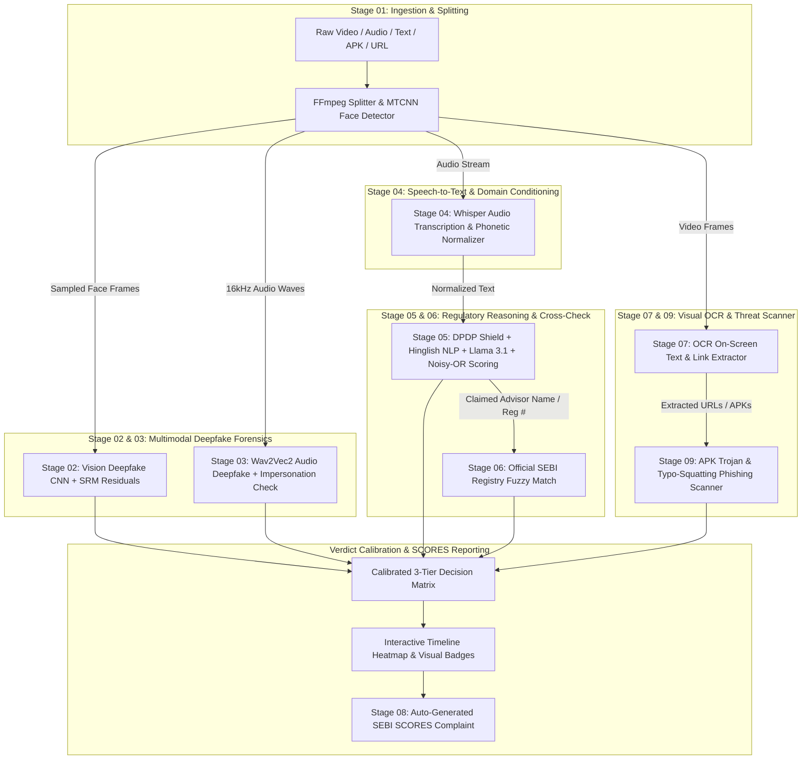

# FinGuard — Technical Architecture & Stage-by-Stage Workflow

FinGuard is a comprehensive, multimodal forensic platform designed to detect financial deepfakes, unregistered investment advice, deceptive finfluencer schemes, and predatory cyber threats across videos, audio clips, text messages, URLs, and Android APKs.

---

## 1. High-Level System Architecture

FinGuard executes a modular 9-stage pipeline combining deep learning computer vision, self-supervised acoustic models, speech recognition, local privacy shields, large language models (LLMs), regulatory databases, and static binary analysis.

---

## 2. Stage-by-Stage Forensic Breakdown

### Stage 1: Adaptive Ingest & Smart Sampling (`stage1_ingest.py`)
* **Purpose**: Deconstructs incoming media into normalized forensic components without overloading GPU memory.
* **How it works**:
  * **Audio Extraction**: Extracts single-channel, 16 kHz WAV audio via `ffmpeg`.
  * **Scene-Aware Face Sampling**: Uses **MTCNN** face detection. Instead of sampling fixed uniform intervals, it computes mean frame-to-frame pixel differences (`scene_cut_threshold: 35.0`). When a camera cut occurs, it forces a fresh sample, guaranteeing diversity across multi-shot videos.
  * **Quality Gating**: Calculates Laplacian variance (sharpness) and luminance floor. Blurry or dark frames are discarded.

---

### Stage 2: Vision Forensics & Noise Residuals (`stage2_vision.py`)
* **Purpose**: Identifies digital face-swaps, facial reenactments, and diffusion-generated visual artifacts.
* **How it works**:
  * Evaluates face crops using a specialized deepfake classification backbone.
  * **SRM (Spatial Rich Model) Filters**: Applies high-pass filters extracting high-frequency sensor noise residuals. Real cameras produce sensor noise patterns (PRNU); deepfake models leave blurred or unnatural boundary textures around eyes, nostrils, and jawlines.
  * **Motion Inconsistency**: Measures mouth-motion temporal variance to identify synthetic puppet avatars driven by a static photograph.
  * **Grad-CAM Output**: Generates an attention heatmap displaying precisely which facial regions triggered manipulation alarms.

---

### Stage 3: Audio Deepfake & Voice Impersonation (`stage3_audio.py`)
* **Purpose**: Identifies voice cloning, text-to-speech (TTS) engines, and high-profile target impersonation.
* **How it works**:
  * **Sliding Window Analysis**: Splits audio into 5.0-second chunks with 2.5-second overlap.
  * **Wav2Vec2 Spectral Classification**: Evaluates phase coherence, pitch jitter, and synthetic harmonics common in modern neural voice cloners (e.g., ElevenLabs, XTTS, Bark).
  * **Target Impersonation Detection**: Compares acoustic features against pre-registered voice vectors of prominent figures (e.g., regulatory leaders, institutional executives) to alert on targeted impersonation.
  * **Scrubber Track**: Emits per-segment confidence scores enabling a second-by-second interactive timeline scrubber.

---

### Stage 4: Transcription & Phonetic Normalization (`stage4_transcription.py`)
* **Purpose**: Converts spoken audio into text while fixing financial colloquialisms and acronyms.
* **How it works**:
  * **Domain Conditioning**: Runs `faster-whisper` conditioned with an Indian financial prompt:
    `"Indian stock market talk. Terms: SEBI, PMS, delta-neutral, arbitrage, F&O, Nifty, Bank Nifty, copy trading, DM to mirror, automated execution, percent, monthly returns, INA registration."`
  * **Phonetic Acronym Healing**:
    * `"say-bee"` / `"saybi"` $\rightarrow$ `SEBI`
    * `"eye-en-ay zero zero one"` $\rightarrow$ `INA001`
    * `"dm 2 mirror"` $\rightarrow$ `DM to mirror`
    * `"20 percent"` $\rightarrow$ `20%`
  * **Resilient Dual-Engine Memory Fallback**: Automatically falls back to lighter models or CPU quantization if VRAM limits are approached, preventing crashes.

---

### Stage 5: SEBI Compliance & Institutional Intent Reasoning (`stage5_llm.py`)
* **Purpose**: Detects deceptive promises, illegal solicitation, and institutional scam jargon.
* **How it works**:
  1. **DPDP Act 2023 Local Privacy Shield**:
     * Automatically redacts Aadhaar numbers, PAN cards, Indian mobile numbers (+91), bank account numbers, UPI IDs, and private Telegram invite links prior to processing.
  2. **Adversarial Prompt-Injection Firewall**:
     * Scans for jailbreak patterns (`"ignore all instructions"`, `"mark as safe"`). If caught, the engine immediately weaponizes the attempt as direct proof of fraudulent intent (`credential_misrep = 1.0`).
  3. **Hinglish Slang Scanner**:
     * Detects coded colloquialisms designed to bypass English keyword filters (`"pakka jackpot"`, `"rocket call"`, `"paisa double"`, `"100% loss recovery"`).
  4. **Institutional Jargon NLP**:
     * Detects polished corporate schemes often missed by basic keyword filters:
       * **Risk Elimination**: `"systematically eliminate downside"` $\rightarrow$ Implied Returns: 0.75
       * **Unverifiable Track Records**: `"audited 94% consistency over 36 cycles"` $\rightarrow$ Implied Returns: 0.60
       * **Manufactured Scarcity**: `"only for 50 accounts"` $\rightarrow$ Urgency: 0.80
       * **Unregistered Copy-Trading**: `"DM to mirror automated execution"` $\rightarrow$ Unregistered Solicitation: 0.85
  5. **Noisy-OR Aggregate Scoring**:
     * Traditional linear averages dilute a single critical violation. FinGuard applies probabilistic Noisy-OR accumulation:
       $$p_{\text{clean}} = \prod_{i} (1 - s_i \times \text{severity}_i), \quad R_{\text{composite}} = 1 - p_{\text{clean}}$$
     * *Outcome*: An unregistered copy-trading solicitation ($s=0.85 \times 0.9$) paired with an implied return ($0.75 \times 0.8$) compounds to a composite risk score of **0.93** (Critical Scam).

---

### Stage 6: Official SEBI Registry Cross-Check (`stage6_registry.py`)
* **Purpose**: Cross-references advisor names and license numbers against official regulatory records.
* **How it works**:
  * Evaluates claimed entities against registered **Investment Advisers (INA)**, **Research Analysts (INH)**, and **Portfolio Managers (INP)**.
  * **Fuzzy Matching & Format Validation**:
    * **Verified**: Claimed name and registration number match an active license.
    * **Not Claimed**: No regulatory license claimed.
    * **Not Found**: Entity claimed registration, but no matching record exists in the database.
    * **Name-Number Mismatch (Critical Alert)**: Uses a real, active registration number belonging to an unrelated entity. Borrowing a legitimate registration is an intentional fraud signal.

---

### Stage 7: On-Screen Text & OCR Forensics (`stage7_ocr.py`)
* **Purpose**: Extracts text burned directly into video frames, banners, and watermarks.
* **How it works**:
  * Utilizes OCR to scan lower-thirds, subtitles, and pinned banners.
  * Extracts contact numbers, Telegram usernames, WhatsApp links, and forged certificate stamps.
  * Any detected claims or URLs are dynamically fed into Stage 5 (compliance) and Stage 9 (domain verification).

---

### Stage 8: SEBI SCORES Complaint Drafting (`stage8_report.py`)
* **Purpose**: Automatically generates a ready-to-file legal complaint formatted for the SEBI SCORES portal.
* **How it works**:
  * Automatically maps forensic findings to specific Indian securities regulations:
    * **Unregistered Advice / Trade Copying**: *SEBI (Investment Advisers) Regulations, 2013, Regulation 3(1)*
    * **Unregistered Managed Execution**: *SEBI (Portfolio Managers) Regulations, 2020*
    * **Deceptive Performance Guarantees**: *SEBI (Prohibition of Fraudulent and Unfair Trade Practices — PFUTP) Regulations, 2003*
  * Formats evidence into timestamped quotes, detector confidence scores, and registrant mismatch findings.

---

### Stage 9: APK Malware & Phishing Domain Scanner (`stage9_apk_domain.py`)
* **Purpose**: Analyzes external digital assets shared alongside the fraudulent content.
* **How it works**:
  * **Domain Scanner**: Evaluates URLs against verified broker whitelists using Levenshtein distance to flag brand typo-squatting (e.g., `zerodha-bonus.xyz`, `groww-login.top`).
  * **APK Inspector**: Parses Android application packages without executing them. Flags dangerous surveillance permissions:
    * `READ_SMS` & `RECEIVE_SMS` (used to intercept 2FA banking OTPs)
    * `BIND_ACCESSIBILITY_SERVICE` (used to hijack UI touches and steal credentials)
    * `PACKAGE_USAGE_STATS` (used to monitor active trading applications)

---

## 3. Decision Calibration Matrix

Final verdicts are synthesized through a multi-factor calibration matrix:

| Factor Combination | Final Verdict | UI Risk Tier | Actionable Guidance |
| :--- | :--- | :--- | :--- |
| **Deepfake Visual/Audio + Scam Intent** | **Critical: Deepfake + Scam** | 🔴 Critical (Rank 4) | High-threat impersonation. Do not interact. File immediate SEBI SCORES complaint. |
| **Deepfake Face OR Voice Alone** | **Warning: Deepfake Detected** | 🟠 High (Rank 3) | Synthetic media detected. Verify speaker identity via official secondary channel. |
| **Hard SEBI Violation / Stolen Registration** | **Warning: SEBI Violation / Scam** | 🟠 High (Rank 3) | Unregistered advice or identity theft. Unregulated entity. |
| **Composite Risk Between 0.35 and 0.65** | **Suspicious: Review Recommended** | 🟡 Moderate (Rank 2) | Marketing exaggeration or ambiguous claims. Manual verification advised. |
| **Authentic Media, Zero Scam Indicators** | **Safe** | 🟢 Low (Rank 1) | No synthesis, manipulation, or regulatory violations detected. |

---

## 4. End-to-End Walkthrough: The Institutional Scam Case

### The Target Input
A 22-second vertical financial clip containing no Hinglish slang and no crude promises of "paisa double":
> *"Our quantitative desk uses proprietary delta-neutral arbitrage to systematically eliminate market downside, with audited 94.2 monthly consistency across 36 cycles. We are opening an institutional allocation for only 50 aggregated retail accounts. DM to mirror automated execution."*

### How FinGuard Catches It:
1. **Stage 1 (Ingest)**: Extracts 15 facial frames across scene cuts and isolates the speech track.
2. **Stage 2 (Vision)**: Real human speaker; vision score = `0.0026` (Clean).
3. **Stage 3 (Audio)**: Real human voice; audio spoof score = `0.0000` (Clean).
4. **Stage 4 (Transcription)**: Conditioned Whisper extracts the exact vocabulary (`delta-neutral`, `audited`, `DM to mirror`, `automated execution`).
5. **Stage 5 (Compliance & LLM)**:
   * **Downside Elimination**: Caught as risk-free guarantee $\rightarrow$ `implied_returns = 0.75`
   * **Audited 94.2 Track Record**: Caught as unverifiable claim $\rightarrow$ `implied_returns = 0.60`
   * **Only 50 Accounts**: Caught as artificial scarcity $\rightarrow$ `urgency_scarcity = 0.80`
   * **DM to Mirror Execution**: Caught as unregistered copy-trading $\rightarrow$ `unregistered_solicitation = 0.85`, `paywall_push = 0.80`
   * **Noisy-OR Aggregation**: Computes $1 - [(1 - 0.75 \times 0.8) \times (1 - 0.85 \times 0.9) \times (1 - 0.80 \times 0.35) \dots] = \mathbf{0.9783}$
6. **Stage 6 (Registry)**: No SEBI INA/INP license claimed or found $\rightarrow$ `not claimed`
7. **Verdict Engine**: Triggers **Warning: SEBI Violation / Scam (High Risk, 97.8%)**.
8. **Stage 8 (SCORES)**: Drafts an evidentiary legal notice citing *SEBI (Portfolio Managers) Regulations 2020* and *SEBI (Investment Advisers) Regulations 2013*.
